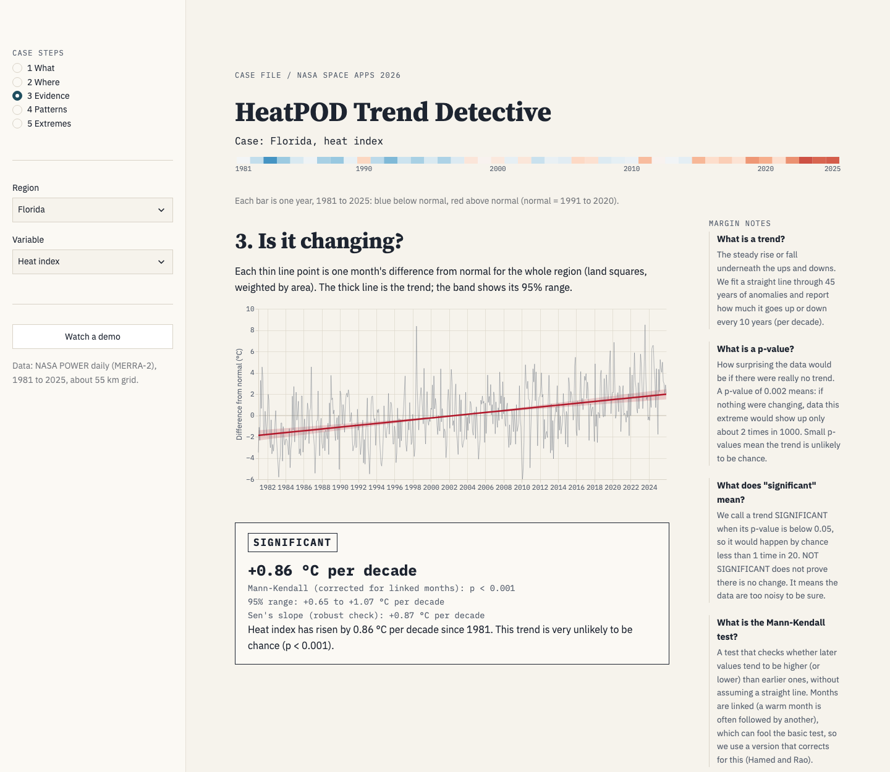
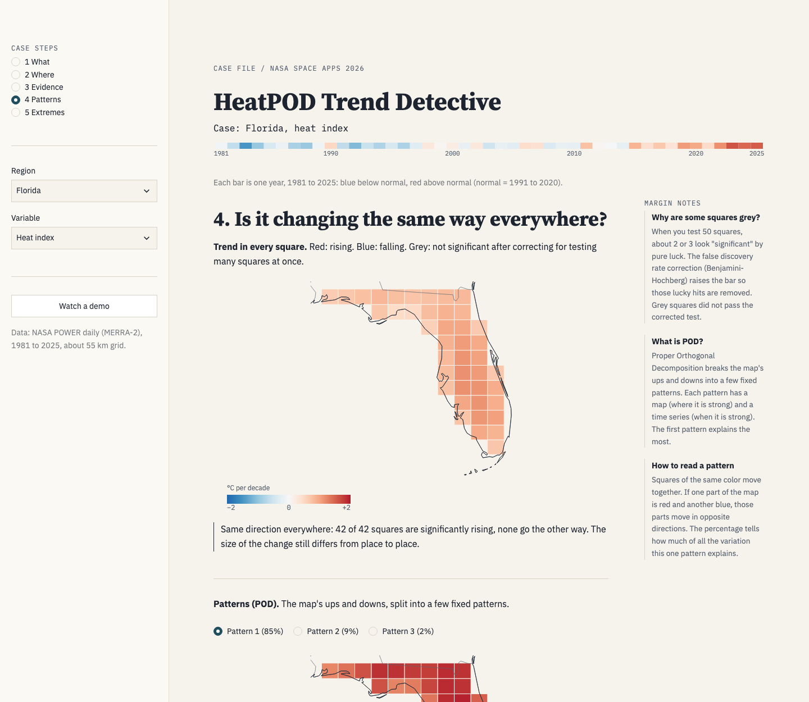
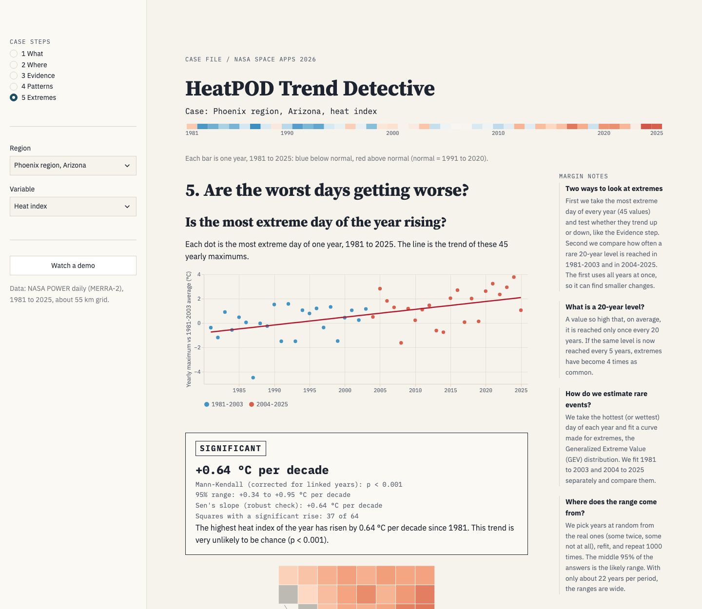

# HeatPOD Trend Detective

A guided investigation of 45 years of NASA weather data (1981 to 2025) that answers three questions in plain words:

1. **Is it changing?** Trend with an autocorrelation-corrected significance test.
2. **Is it changing the same way everywhere?** Per-square trend map and POD pattern maps.
3. **Are the worst days getting worse?** Extreme value analysis of each year's most extreme day.

Built for the NASA Space Apps Challenge 2026, challenge **Be an Earth System Trend Detective!**

**Live app:** https://heatpod-trend-detective.streamlit.app/
**Code:** https://github.com/moezalikhan/heatpod-trend-detective



## Two demo cases

Florida (humid heat) and Phoenix region, Arizona (dry heat): same country, same NASA data, opposite kinds of heat.

| | Florida (humid heat) | Phoenix region, Arizona (dry heat) |
|---|---|---|
| Air temperature | +0.33 °C per decade, significant, all 42 squares | +0.44 °C per decade, significant, all 64 squares |
| Heat index ("feels like") | **+0.86 °C per decade**, significant: rising more than twice as fast as air temperature | +0.44 °C per decade, significant |
| Humidity | no clear trend | **-1.5 percentage points per decade**, significant |
| Rain | no clear trend | -0.08 mm/day per decade, significant (about -9% of its average per decade) |
| Hottest day of the year | +0.16 °C per decade, no clear trend region-wide (p = 0.08); the highest heat index of the year rises significantly in 21 of 42 squares (south peninsula) | **+0.31 °C per decade, significant** (p = 0.018); highest heat index of the year +0.64 °C per decade (p < 0.001) |
| 20-year level | no clear change: the sea and afternoon storms cap Florida's extremes | heat index level that came once every 20 years now comes about every 2 years (see limitations) |

All numbers are for 1981 to 2025, from monthly anomalies (seasonal cycle removed).

## How to use it

Pick a region and a variable in the sidebar, then walk through the five steps: **What** (the variable, in plain words), **Where** (the map and the grid squares), **Evidence** (time series, trend line, verdict box), **Patterns** (trend in every square and POD patterns), **Extremes** (how often rare extremes happen now). Margin notes explain every term for a high school reader. **Watch a demo** walks through Florida's heat index step by step.

Links open a specific case, for example `?region=phoenix&variable=HEAT_INDEX&step=extremes`.

| | |
|---|---|
|  |  |

## Data

- **NASA POWER** daily regional API (most weather variables from **MERRA-2**), about 55 km grid (0.5 x 0.625 degrees), 1 January 1981 to 31 December 2025, local solar time.
- Variables: `T2M` air temperature at 2 m, `T2M_MAX` daily maximum temperature, `RH2M` relative humidity, `PRECTOTCORR` precipitation, plus the **NOAA heat index** calculated from `T2M_MAX` and `RH2M`.
- Regions: Florida (24.5 to 31.0 N, 87.6 to 80.0 W) and Phoenix (31.5 to 35.5 N, 114.5 to 110.0 W). Only squares whose center is on land inside the state are kept (Natural Earth 1:50m land and US states), leaving out squares centered on a state or country border: 42 squares in Florida, 64 in Arizona.

## Method

| Step | What we do | Why |
|---|---|---|
| Anomalies | Monthly means minus each calendar month's 1991 to 2020 average | Removes summer and winter so only slow change is left |
| Regional series | Land squares only, weighted by cos(latitude) | Squares shrink toward the poles |
| Trend size | Least-squares slope per decade; 95% interval widened with an effective sample size from the lag-1 autocorrelation | Neighbouring months are linked, which would make a naive interval too narrow |
| Significance | **Mann-Kendall, Hamed-Rao correction with 12 lags**, never less strict than the basic test | See validation below |
| Robust check | Sen's slope | Outliers do not drive the result |
| Many squares | Benjamini-Hochberg false discovery rate | Removes "significant by luck" squares |
| Patterns | POD (EOF) by SVD of the area-weighted anomaly matrix; North's rule of thumb for mode separation | Shows where the region moves together or in opposite directions |
| Extremes, trend | Corrected Mann-Kendall (3 lags) and Sen's slope on the 45 yearly maximums; SIGNIFICANT only when the test and the widened 95% range agree; per square with Benjamini-Hochberg | Uses all years at once, so it has more power than comparing two periods |
| Extremes, rare levels | GEV fit to yearly maxima for 1981-2003 and 2004-2025 with a shared shape (bounded to -0.5..0.5); 20-year return levels; 1000-sample bootstrap | 22 values per period are too few for a free shape parameter |

## Validation

- **79 pipeline tests** on fake data with known answers, **64 app tests** (Streamlit AppTest: every step, both regions, every variable, the demo). All run in GitHub Actions on every push.
- **Simulation of the trend test** (1500 series of 540 months, 5% level):

  | Test | Pure noise | Linked months (0.6) | Strongly linked (0.8) |
  |---|---|---|---|
  | Basic Mann-Kendall | 6.0% | 32.5% | 51.1% |
  | Our corrected test | 6.0% | 6.9% | 8.1% |

  The pymannkendall default Hamed-Rao settings gave 10 to 16% false alarms on linked months, so we changed them.
- **Yearly maximum trend:** in simulation (45 years) 3 to 7% false alarms and 89% of real trends found.
- **Extremes test:** 6 false alarms in 100 simulated no-change cases; fitting large simulated GEV samples gives back the parameters used to create them.
- **Check against NASA's point service** (used by the POWER Data Access Viewer): the Phoenix square at 33.5 N, 112.5 W matches our downloaded grid exactly for all 366 days of 2020 and all four variables (`python -m pipeline.heatpod.check_point`).

## Limitations

- **Heat index is approximate.** NASA POWER gives daily maximum temperature and daily *average* humidity; afternoons are drier, so heat index values run high, especially extremes. The app shows trends and how often extremes happen, not absolute heat index extremes.
- **Phoenix heat index extremes:** the fitted shape hit its limit, so the likely range shown is probably too narrow. The app says so next to the result.
- **Model data, not stations.** MERRA-2 is a reanalysis on a 55 km grid; city heat islands and local storms are smoothed out.
- **Extremes compare two 22-year periods,** so their uncertainty ranges are wide; the test is on the cautious side.

## Architecture

```
[laptop pipeline]  NASA POWER API -> download (cache, retries, rate limit) -> clean -> trends / POD / extremes -> data/results/ (0.7 MB)
[Streamlit app]    reads data/results/ only, never calls NASA
[GitHub Actions]   tests on every push; only when both test jobs pass is main copied to the `live` branch,
                   which Streamlit Community Cloud deploys
```

## Run it yourself

```bash
python3.11 -m venv .venv && source .venv/bin/activate
pip install -r requirements.txt -r pipeline/requirements.txt

# App only (uses the committed results)
streamlit run streamlit_app.py

# Full pipeline (about an hour, mostly polite waiting between NASA requests)
python -m pipeline.heatpod.download     # data/raw/ (not committed)
python -m pipeline.heatpod.clean
python -m pipeline.heatpod.export       # data/results/, validated against config/results_schema.yaml

# Tests
pytest pipeline/tests
pytest tests
```

## Project structure

```
streamlit_app.py        app entry point
app/                    data loader, step views, chart builders, styles, glossary
config/                 regions, variables (one catalog for pipeline and app), results schema
pipeline/heatpod/       download, clean, trends, pod, extremes, export, check_point
pipeline/tests/, tests/ pipeline unit tests and Streamlit AppTests
data/results/           small results files read by the app
.github/workflows/      ci.yml (every push), release.yml (tests, then update `live`)
```

## Credits and use of AI

- Data: NASA POWER (NASA Langley Research Center), MERRA-2 (NASA GMAO). Land and border shapes: Natural Earth.
- Fonts: IBM Plex Sans, IBM Plex Mono (IBM), Source Serif 4 (Adobe), SIL Open Font License.
- Colors: ColorBrewer RdBu and YlOrRd.
- AI assistance: the code was written with Claude Code (Anthropic) under the author's direction; method choices were checked with simulations and tests, as documented above.

## License

MIT, see [LICENSE](LICENSE). Font files: SIL Open Font License, see `static/licenses/`.
